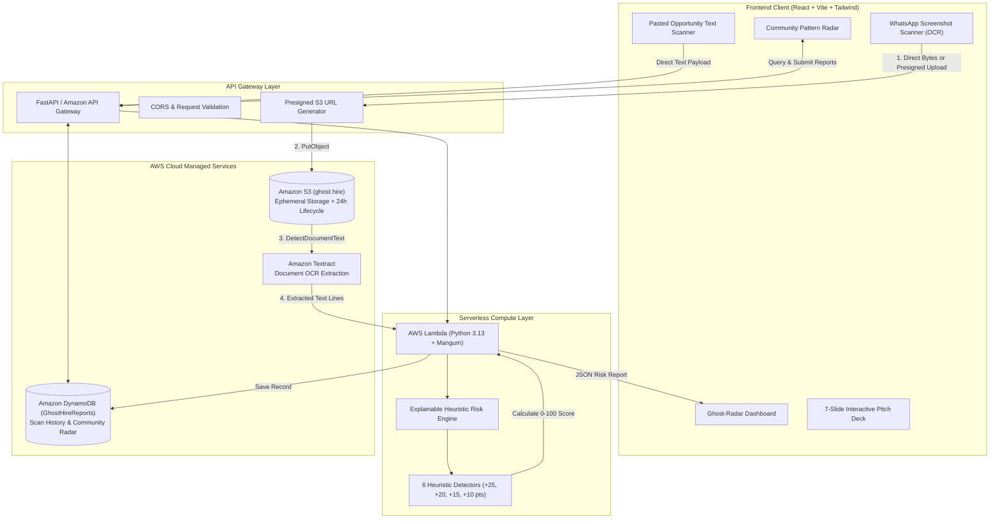
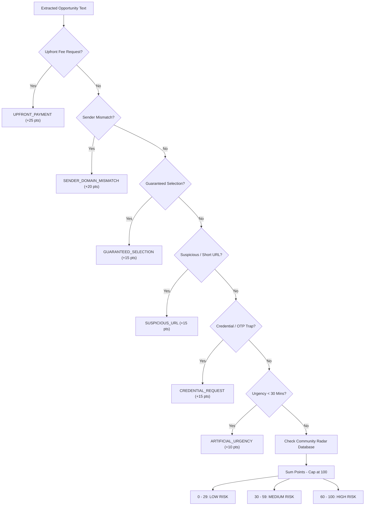
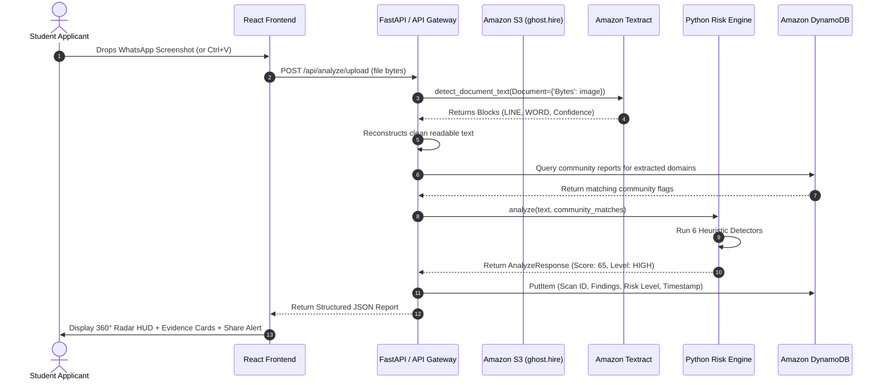

# 🏛️ GhostHire — Complete System Architecture & Engineering Specifications

> **Hack-to-ween 2026 / Open Innovation Track**  
> Evidence-Based Opportunity Verification Platform for Students & Placement Cells

---

## 1. Executive Architecture Summary

GhostHire is designed to solve the campus employment fraud epidemic. The platform combines an **explainable heuristic risk engine**, **Amazon Textract document OCR**, **Amazon S3 ephemeral storage**, and **Amazon DynamoDB** into a decoupled, zero-secret serverless architecture.

---

## 2. Component Breakdown

### 2.1 Frontend Client (`frontend/`)
* **Framework**: React 18, Vite 5, Tailwind CSS 3.
* **Theme System**: Dedicated Halloween palette:
  * Background: Deep near-black purple (`#100D19`)
  * Cards: Dark plum (`#211A2D`)
  * Primary Accent: Halloween orange (`#FF8A3D`)
  * Secondary Accent: Electric lavender (`#9B7BFF`)
  * Danger: Coral red (`#FF5B66`)
* **Key Modules**:
  * `GhostRadarVisual.jsx`: Real-time radar scanning HUD with $360^\circ$ sweep beam and threat blips.
  * `OpportunityScanner.jsx`: Handles WhatsApp screenshots, clipboard paste (`Ctrl+V`), and pasted text.
  * `RiskReportCard.jsx`: Itemized findings breakdown, exact quoted evidence, and copyable WhatsApp alert formatter.
  * `CommunityRadar.jsx`: Anonymized student crowdsourced reporting and domain risk intelligence.
  * `PitchDeckViewer.jsx`: Embedded 7-slide pitch presentation for judges.
  * `ArchitectureModal.jsx`: In-app architecture and data-flow explorer.

---

### 2.2 Backend Application (`backend/`)
* **Framework**: Python 3.13 + FastAPI + Uvicorn + Mangum (ASGI adapter for AWS Lambda).
* **Endpoints**:
  | Method | Route | Description |
  | :--- | :--- | :--- |
  | `POST` | `/api/analyze` | Evaluates raw pasted opportunity text against heuristic rules. |
  | `POST` | `/api/analyze/upload` | Accepts screenshot image, runs Amazon Textract OCR, and evaluates extracted text. |
  | `POST` | `/api/report` | Submits student-flagged domain report with explicit consent metadata. |
  | `GET` | `/api/community/{domain}` | Returns verified community reports and threat indicator for a domain. |
  | `GET` | `/api/history` | Fetches recent scan audit history from DynamoDB. |
  | `GET` | `/api/config` | Reports AWS connectivity status and active regions. |
  | `GET` | `/api/upload/presigned` | Issues 5-minute presigned S3 URLs for direct client-to-S3 uploads. |
  | `GET` | `/api/sample-whatsapp-image`| Serves a realistic WhatsApp scam screenshot for one-click testing. |

---

## 3. Explainable Heuristic Risk Engine

Unlike generative AI chatbots that hallucinate fraud determinations, GhostHire's risk engine is **deterministic, mathematical, and auditable**.

### Scoring Matrix:
1. **`UPFRONT_PAYMENT` (+25 pts)**: Identifies registration, laptop, training, or refundable deposit fees (e.g. *"Pay ₹999 registration fee"*).
2. **`SENDER_DOMAIN_MISMATCH` (+20 pts)**: Detects recruiters claiming to represent Google, Microsoft, TCS, etc., but using free webmail (`@gmail.com`).
3. **`GUARANTEED_SELECTION` (+15 pts)**: Flags offers promising 100% selection without interviews or technical evaluations.
4. **`SUSPICIOUS_URL` (+15 pts)**: Flags shortened domains (`bit.ly`, `tinyurl`) and suspicious TLDs (`.xyz`, `.top`).
5. **`CREDENTIAL_REQUEST` (+15 pts)**: Identifies attempts to collect OTPs, UPI PINs, Aadhaar numbers, or bank passwords.
6. **`ARTIFICIAL_URGENCY` (+10 pts)**: Detects artificial countdowns (e.g. *"Reply within 30 minutes or lose your seat"*).
7. **`COMMUNITY_REPORTS` (+10 to +25 pts)**: Penalty applied if associated domains have prior verified student fraud reports.

---

## 4. End-to-End Data Flow Sequence

---

## 5. Security & Privacy Guardrails

1. **Zero Frontend Secrets**: No AWS IAM Access Keys or Secret Keys are ever bundled in client-side JavaScript.
2. **Short-Lived S3 Presigned URLs**: Direct browser uploads use cryptographically signed S3 URLs that expire after 300 seconds.
3. **Ephemeral Image Lifecycle**: Screenshots uploaded to Amazon S3 are configured with a 24-hour expiration lifecycle policy to protect user privacy.
4. **Non-Defamatory Prioritization**: GhostHire flags heuristic risk signals and recommends verification steps; it explicitly does not declare companies guilty of criminal fraud.
5. **Consensual Community Sharing**: Pattern sharing requires explicit opt-in consent from the student.

---

## 6. AWS Service Summary

| AWS Service | Resource / Target | Purpose in GhostHire |
| :--- | :--- | :--- |
| **Amazon S3** | `ghost.hire` | Ephemeral screenshot storage with automated 24h lifecycle deletion. |
| **Amazon Textract** | `detect_document_text` | Machine-learning OCR for extracting text lines from mobile screenshots. |
| **Amazon DynamoDB** | `GhostHireReports` | Low-latency storage of scan audit records and community domain reports. |
| **AWS Lambda** | Python 3.13 runtime via Mangum | Serverless hosting of the explainable risk engine. |
| **Amazon API Gateway** | HTTP API Routes | Routes client requests with CORS, rate-limiting, and payload validation. |
